 
<<<
'''
 
[[rullebane]]
=== Objekttype: Rullebane
*Definisjon fra FKB produktspesifikasjon*: omr&#229;de definert som en lufthavns rullebane 
 
 
.Illustrasjon fra produktspesifikasjon av Rullebane
image::https://skjema.geonorge.no/SOSI/produktspesifikasjon/FKB-Lufthavn/5.1/figurer/objtype_rullebane.png[link=https://skjema.geonorge.no/SOSI/produktspesifikasjon/FKB-Lufthavn/5.1/figurer/objtype_rullebane.png, Alt="Illustrasjon fra produktspesifikasjon: Rullebane"]
 
 
[discrete]
==== Tilleggsinformasjon for fotogrammetrisk registrering
Skal registreres som lukket areal (heleid flategeometri).

Rullebaneflaten er rektangul&#230;r, og f&#248;lger ytterkant av hvit oppmerking langs rullebanen og ytterkant av gul oppmerking i rullebaneendene. 

Rullebane vil vanligvis v&#230;re knyttet til en eller flere Taksebaner. I overgangen mellom Rullebane og Taksebane skal det benyttes lik avgrensning (ikke overlapp eller gap mellom flatene)
 
 
'''
.Rullebaner registreres som rektangler. Snulommer (vendehammer) som vist på denne skissa inngår ikke i Rullebane og registreres i stedet som egne Taksebane-flater.
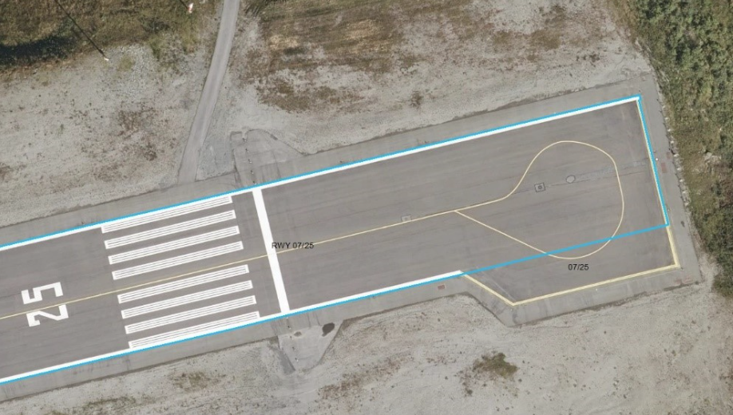
 
 
 
[discrete]
==== Føringer
[cols="h,2"]
|===
|FKB-A
|Påkrevd registrering
 
|FKB-B
|Påkrevd registrering
 
|FKB-C
|Påkrevd registrering
 
|FKB-D
|Påkrevd registrering
 
|FKB grunnrissreferanse
|Ytterkant oppmerking
 
|FKB høydereferanse
|Terreng/dekke
 
|===
 
 
<<<
 
[discrete]
==== Egenskapstabell for objekttype: Rullebane
[cols="20,20,20,10", options="header"]
|===
|*Navn:* 
|*Type:* 
|*SOSI_navn:* 
|*Mult.:* 
 
|identifikasjon
|«dataType» Identifikasjon
|..IDENT
|[0..1]
 
|identifikasjon.lokalId
|CharacterString
|...LOKALID
|[1..1]
 
|identifikasjon.navnerom
|CharacterString
|...NAVNEROM
|[1..1]
 
|identifikasjon.versjonId
|CharacterString
|...VERSJONID
|[0..1]
 
|oppdateringsdato
|DateTime
|..OPPDATERINGSDATO
|[0..1]
 
|sluttdato
|DateTime
|..SLUTTDATO
|[0..1]
 
|datafangstdato
|Date
|..DATAFANGSTDATO
|[1..1]
 
|verifiseringsdato
|Date
|..VERIFISERINGSDATO
|[0..1]
 
|registreringsversjon
| «CodeList»  https://register.geonorge.no/sosi-kodelister/fkb/generell/5.0/registreringsversjon[Registreringsversjon, window = _blank]
|..REGISTRERINGSVERSJON
|[0..1]
 
|informasjon
|CharacterString
|..INFORMASJON
|[0..1]
 
|kvalitet
|«dataType» Posisjonskvalitet
|..KVALITET
|[1..1]
 
|kvalitet.datafangstmetode
| «CodeList»  https://register.geonorge.no/sosi-kodelister/fkb/generell/5.0/datafangstmetode[Datafangstmetode, window = _blank]
|...DATAFANGSTMETODE
|[1..1]
 
|kvalitet.nøyaktighet
|Integer
|...NØYAKTIGHET
|[0..1]
 
|kvalitet.synbarhet
| «CodeList»  https://register.geonorge.no/sosi-kodelister/fkb/generell/5.0/synbarhet[Synbarhet, window = _blank]
|...SYNBARHET
|[0..1]
 
|kvalitet.datafangstmetodeHøyde
| «CodeList»  https://register.geonorge.no/sosi-kodelister/fkb/generell/5.0/datafangstmetode[Datafangstmetode, window = _blank]
|...DATAFANGSTMETODEHØYDE
|[0..1]
 
|kvalitet.nøyaktighetHøyde
|Integer
|...H-NØYAKTIGHET
|[0..1]
 
|område
|GM_Surface
|.FLATE
|[1..1]
 
|eksternpeker
|URI
|..EKSTERNPEKER
|[0..1]
 
|===
 
<<<
'''
 
[[taksebane]]
=== Objekttype: Taksebane
*Definisjon fra FKB produktspesifikasjon*: bane eller rute p&#229; en flyplass opprettet til bruk for taksende luftfart&#248;yer i den hensikt &#229; virke som en forbindelse mellom ulike deler av flyplassen
 
 
.Illustrasjon fra produktspesifikasjon av Taksebane
image::https://skjema.geonorge.no/SOSI/produktspesifikasjon/FKB-Lufthavn/5.1/figurer/objtype_taksebane.png[link=https://skjema.geonorge.no/SOSI/produktspesifikasjon/FKB-Lufthavn/5.1/figurer/objtype_taksebane.png, Alt="Illustrasjon fra produktspesifikasjon: Taksebane"]
 
 
[discrete]
==== Tilleggsinformasjon for fotogrammetrisk registrering
Skal registreres som lukket areal (heleid flategeometri).

Taksebaner skal normalt v&#230;re knyttet til en Rullebane og/eller en Oppstillingsplattform. I overgangen mellom Taksebane og Rullebane/Oppstillingsplattform skal det benyttes lik avgrensning (ikke overlapp eller gap mellom flatene)

Registreres ytterkant taksebaneoppmerking. Der det ikke er oppmerking registreres asfaltkant. 

Taksebane kan ogs&#229; ligge mellom rullebaner eller langs rullebane. Det kan ogs&#229; v&#230;re taksebane i omr&#229;det utenfor rullebanen ved snuplass i enden av rullebanen (vendehammeren).

 
 
'''
.Viser registrering av taksebane (rødt) og oppstillingsplattform (blått). Områdene er skilt av oppmerking.
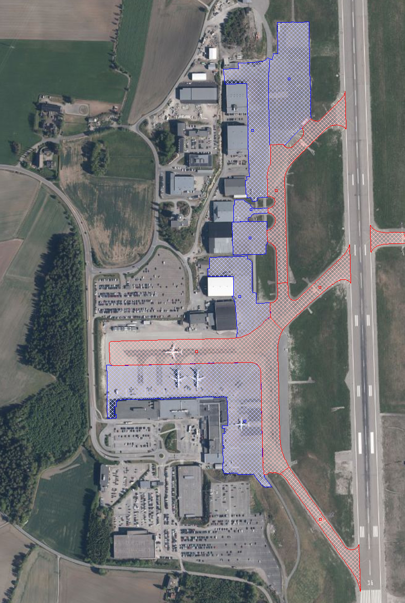
 
 
'''
.Viser registrering av taksebane-flater i forbindelse med snuplass/vendehammer i enden av rullebane
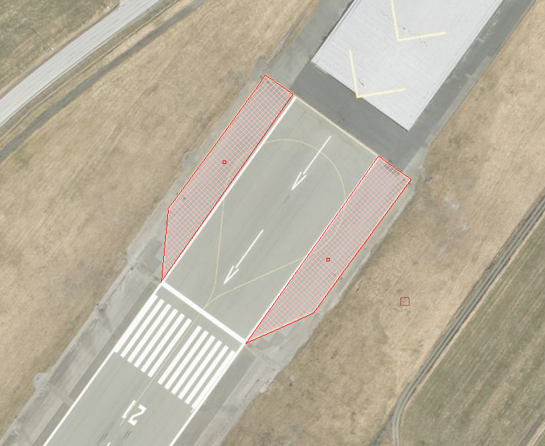
 
 
 
[discrete]
==== Føringer
[cols="h,2"]
|===
|FKB-A
|Påkrevd registrering
 
|FKB-B
|Påkrevd registrering
 
|FKB-C
|Påkrevd registrering
 
|FKB-D
|Påkrevd registrering
 
|FKB grunnrissreferanse
|Oppmerking, dekkekant
 
|FKB høydereferanse
|Terreng/dekke
 
|===
 
 
<<<
 
[discrete]
==== Egenskapstabell for objekttype: Taksebane
[cols="20,20,20,10", options="header"]
|===
|*Navn:* 
|*Type:* 
|*SOSI_navn:* 
|*Mult.:* 
 
|identifikasjon
|«dataType» Identifikasjon
|..IDENT
|[0..1]
 
|identifikasjon.lokalId
|CharacterString
|...LOKALID
|[1..1]
 
|identifikasjon.navnerom
|CharacterString
|...NAVNEROM
|[1..1]
 
|identifikasjon.versjonId
|CharacterString
|...VERSJONID
|[0..1]
 
|oppdateringsdato
|DateTime
|..OPPDATERINGSDATO
|[0..1]
 
|sluttdato
|DateTime
|..SLUTTDATO
|[0..1]
 
|datafangstdato
|Date
|..DATAFANGSTDATO
|[1..1]
 
|verifiseringsdato
|Date
|..VERIFISERINGSDATO
|[0..1]
 
|registreringsversjon
| «CodeList»  https://register.geonorge.no/sosi-kodelister/fkb/generell/5.0/registreringsversjon[Registreringsversjon, window = _blank]
|..REGISTRERINGSVERSJON
|[0..1]
 
|informasjon
|CharacterString
|..INFORMASJON
|[0..1]
 
|kvalitet
|«dataType» Posisjonskvalitet
|..KVALITET
|[1..1]
 
|kvalitet.datafangstmetode
| «CodeList»  https://register.geonorge.no/sosi-kodelister/fkb/generell/5.0/datafangstmetode[Datafangstmetode, window = _blank]
|...DATAFANGSTMETODE
|[1..1]
 
|kvalitet.nøyaktighet
|Integer
|...NØYAKTIGHET
|[0..1]
 
|kvalitet.synbarhet
| «CodeList»  https://register.geonorge.no/sosi-kodelister/fkb/generell/5.0/synbarhet[Synbarhet, window = _blank]
|...SYNBARHET
|[0..1]
 
|kvalitet.datafangstmetodeHøyde
| «CodeList»  https://register.geonorge.no/sosi-kodelister/fkb/generell/5.0/datafangstmetode[Datafangstmetode, window = _blank]
|...DATAFANGSTMETODEHØYDE
|[0..1]
 
|kvalitet.nøyaktighetHøyde
|Integer
|...H-NØYAKTIGHET
|[0..1]
 
|område
|GM_Surface
|.FLATE
|[1..1]
 
|eksternpeker
|URI
|..EKSTERNPEKER
|[0..1]
 
|===
 
<<<
'''
 
[[oppstillingsplattform]]
=== Objekttype: Oppstillingsplattform
*Definisjon fra FKB produktspesifikasjon*: omr&#229;de for oppstilling av luftfart&#248;y p&#229; en lufthavn. Oppstillingsplattform inkluderer oppstillingsplasser, avisingsomr&#229;der, drivstoffp&#229;fyllingsomr&#229;der og vedlikeholdsomr&#229;der.
 
 
.Illustrasjon fra produktspesifikasjon av Oppstillingsplattform
image::https://skjema.geonorge.no/SOSI/produktspesifikasjon/FKB-Lufthavn/5.1/figurer/objtype_oppstillingsplattform.png[link=https://skjema.geonorge.no/SOSI/produktspesifikasjon/FKB-Lufthavn/5.1/figurer/objtype_oppstillingsplattform.png, Alt="Illustrasjon fra produktspesifikasjon: Oppstillingsplattform"]
 
 
[discrete]
==== Tilleggsinformasjon for fotogrammetrisk registrering
Skal registreres som lukket areal (heleid flategeometri).

Oppstillingsplattform vil vanligvis v&#230;re knyttet til en eller flere Taksebaner. I overgangen mellom Oppstillingsplattform og Taksebane skal det benyttes lik avgrensning (ikke overlapp eller gap mellom flatene)

Oppstillingsplattformen starter ofte ved &#171;Grense for man&#248;vreringsomr&#229;de&#187; eller &#171;Venteposisjon&#187; og f&#248;res fram til oppstillingsplattformkant, bygninger eller sikkerhetslinje. Der det ikke er kantoppmerking kan det registreres langs ytterkant av fast dekke dersom det er en naturlig kant p&#229; oppstillingsplattformen.

 
 
'''
.Oppstillingsplattform tydelig avgrenset av oppmerking
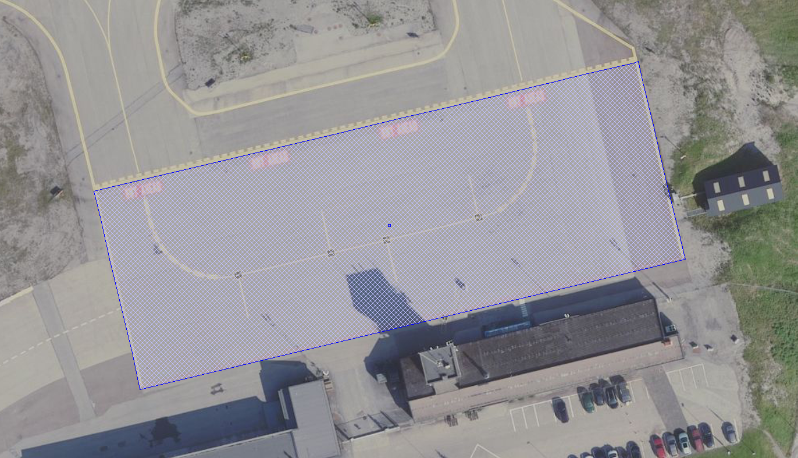
 
 
 
[discrete]
==== Føringer
[cols="h,2"]
|===
|FKB-A
|Påkrevd registrering
 
|FKB-B
|Påkrevd registrering
 
|FKB-C
|Påkrevd registrering
 
|FKB-D
|Påkrevd registrering
 
|FKB grunnrissreferanse
|Langside: Ytterkant oppmerking kantstripe,Kortside: Gjennom Terskelpunktet (LufthavnFastmerke) evt. midten oppmerking terskelbar
 
|FKB høydereferanse
|Terreng/dekke
 
|===
 
 
<<<
 
[discrete]
==== Egenskapstabell for objekttype: Oppstillingsplattform
[cols="20,20,20,10", options="header"]
|===
|*Navn:* 
|*Type:* 
|*SOSI_navn:* 
|*Mult.:* 
 
|identifikasjon
|«dataType» Identifikasjon
|..IDENT
|[0..1]
 
|identifikasjon.lokalId
|CharacterString
|...LOKALID
|[1..1]
 
|identifikasjon.navnerom
|CharacterString
|...NAVNEROM
|[1..1]
 
|identifikasjon.versjonId
|CharacterString
|...VERSJONID
|[0..1]
 
|oppdateringsdato
|DateTime
|..OPPDATERINGSDATO
|[0..1]
 
|sluttdato
|DateTime
|..SLUTTDATO
|[0..1]
 
|datafangstdato
|Date
|..DATAFANGSTDATO
|[1..1]
 
|verifiseringsdato
|Date
|..VERIFISERINGSDATO
|[0..1]
 
|registreringsversjon
| «CodeList»  https://register.geonorge.no/sosi-kodelister/fkb/generell/5.0/registreringsversjon[Registreringsversjon, window = _blank]
|..REGISTRERINGSVERSJON
|[0..1]
 
|informasjon
|CharacterString
|..INFORMASJON
|[0..1]
 
|kvalitet
|«dataType» Posisjonskvalitet
|..KVALITET
|[1..1]
 
|kvalitet.datafangstmetode
| «CodeList»  https://register.geonorge.no/sosi-kodelister/fkb/generell/5.0/datafangstmetode[Datafangstmetode, window = _blank]
|...DATAFANGSTMETODE
|[1..1]
 
|kvalitet.nøyaktighet
|Integer
|...NØYAKTIGHET
|[0..1]
 
|kvalitet.synbarhet
| «CodeList»  https://register.geonorge.no/sosi-kodelister/fkb/generell/5.0/synbarhet[Synbarhet, window = _blank]
|...SYNBARHET
|[0..1]
 
|kvalitet.datafangstmetodeHøyde
| «CodeList»  https://register.geonorge.no/sosi-kodelister/fkb/generell/5.0/datafangstmetode[Datafangstmetode, window = _blank]
|...DATAFANGSTMETODEHØYDE
|[0..1]
 
|kvalitet.nøyaktighetHøyde
|Integer
|...H-NØYAKTIGHET
|[0..1]
 
|område
|GM_Surface
|.FLATE
|[1..1]
 
|eksternpeker
|URI
|..EKSTERNPEKER
|[0..1]
 
|===
 
<<<
'''
 
[[helikopterlandingsplass]]
=== Objekttype: Helikopterlandingsplass
*Definisjon fra FKB produktspesifikasjon*: definert omr&#229;de for landing og letting med helikopter.
 
 
.Illustrasjon fra produktspesifikasjon av Helikopterlandingsplass
image::https://skjema.geonorge.no/SOSI/produktspesifikasjon/FKB-Lufthavn/5.1/figurer/objtype_helikopterlandingsplass.png[link=https://skjema.geonorge.no/SOSI/produktspesifikasjon/FKB-Lufthavn/5.1/figurer/objtype_helikopterlandingsplass.png, Alt="Illustrasjon fra produktspesifikasjon: Helikopterlandingsplass"]
 
 
[discrete]
==== Tilleggsinformasjon for fotogrammetrisk registrering
Landingsplassen er merket med kryss og eventuelt "H". Omr&#229;det som skal registreres avgrenses av oppmerkingen (vanligvis sirkel) rundt landingsplassen.

Dersom det ikke finnes noen tydelig oppmerking rundt landingsplassen registreres en sirkel rundt kryss eller "H" og lavere n&#248;yaktighet angis i kvalitetskodingen. 

Landingsplassene finnes inne p&#229; Lufthavner og i forbindelse med sykehus, legevakter eller andre typer bygninger i forbindelse med beredskap og redning.

Landingsplassen kan ligge p&#229; bakken, p&#229; bygning (medium B) eller i luft (medium L).
 
 
'''
.Viser ekspempel på at oppmerking av landingsplass (område som skal registreres) ikke nødvendigvis trenger å være formet som en sirkel
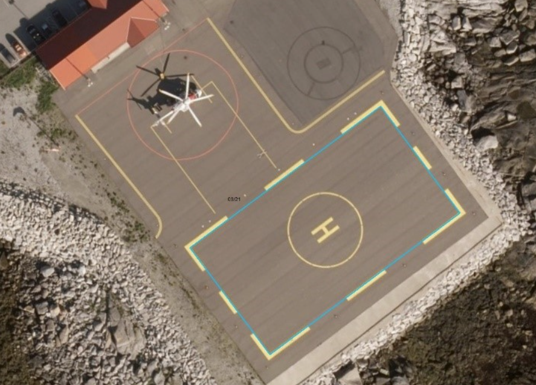
 
 
 
[discrete]
==== Føringer
[cols="h,2"]
|===
|FKB-A
|Påkrevd registrering
 
|FKB-B
|Påkrevd registrering
 
|FKB-C
|Opsjonell registrering
 
|FKB-D
|Opsjonell registrering
 
|FKB grunnrissreferanse
|Oppmerking
 
|FKB høydereferanse
|Dekke landingsplass
 
|===
 
 
<<<
 
[discrete]
==== Egenskapstabell for objekttype: Helikopterlandingsplass
[cols="20,20,20,10", options="header"]
|===
|*Navn:* 
|*Type:* 
|*SOSI_navn:* 
|*Mult.:* 
 
|identifikasjon
|«dataType» Identifikasjon
|..IDENT
|[0..1]
 
|identifikasjon.lokalId
|CharacterString
|...LOKALID
|[1..1]
 
|identifikasjon.navnerom
|CharacterString
|...NAVNEROM
|[1..1]
 
|identifikasjon.versjonId
|CharacterString
|...VERSJONID
|[0..1]
 
|oppdateringsdato
|DateTime
|..OPPDATERINGSDATO
|[0..1]
 
|sluttdato
|DateTime
|..SLUTTDATO
|[0..1]
 
|datafangstdato
|Date
|..DATAFANGSTDATO
|[1..1]
 
|verifiseringsdato
|Date
|..VERIFISERINGSDATO
|[0..1]
 
|registreringsversjon
| «CodeList»  https://register.geonorge.no/sosi-kodelister/fkb/generell/5.0/registreringsversjon[Registreringsversjon, window = _blank]
|..REGISTRERINGSVERSJON
|[0..1]
 
|informasjon
|CharacterString
|..INFORMASJON
|[0..1]
 
|kvalitet
|«dataType» Posisjonskvalitet
|..KVALITET
|[1..1]
 
|kvalitet.datafangstmetode
| «CodeList»  https://register.geonorge.no/sosi-kodelister/fkb/generell/5.0/datafangstmetode[Datafangstmetode, window = _blank]
|...DATAFANGSTMETODE
|[1..1]
 
|kvalitet.nøyaktighet
|Integer
|...NØYAKTIGHET
|[0..1]
 
|kvalitet.synbarhet
| «CodeList»  https://register.geonorge.no/sosi-kodelister/fkb/generell/5.0/synbarhet[Synbarhet, window = _blank]
|...SYNBARHET
|[0..1]
 
|kvalitet.datafangstmetodeHøyde
| «CodeList»  https://register.geonorge.no/sosi-kodelister/fkb/generell/5.0/datafangstmetode[Datafangstmetode, window = _blank]
|...DATAFANGSTMETODEHØYDE
|[0..1]
 
|kvalitet.nøyaktighetHøyde
|Integer
|...H-NØYAKTIGHET
|[0..1]
 
|område
|GM_Surface
|.FLATE
|[1..1]
 
|eksternpeker
|URI
|..EKSTERNPEKER
|[0..1]
 
|===
 
<<<
'''
 
[[lufthavnlys]]
=== Objekttype: Lufthavnlys
*Definisjon fra FKB produktspesifikasjon*: spesielle lys for en lufthavn tiltenkt navigasjon og visualisering av oppmerking i mørket
 
 
.Illustrasjon fra produktspesifikasjon av Lufthavnlys
image::https://skjema.geonorge.no/SOSI/produktspesifikasjon/FKB-Lufthavn/5.1/figurer/objtype_lufthavnlys.png[link=https://skjema.geonorge.no/SOSI/produktspesifikasjon/FKB-Lufthavn/5.1/figurer/objtype_lufthavnlys.png, Alt="Illustrasjon fra produktspesifikasjon: Lufthavnlys"]
 
 
[discrete]
==== Tilleggsinformasjon for fotogrammetrisk registrering
Alle lufthavnlys klassifiseres som Annen lufthavnbelysning (..LHLYSTYPE 99) dersom det ikke blir levert manus for klassifisering i de forskjellige lufthavnlystypene. 

I kartleggingsprosjekter der Avinor (lufthavneier) ikke deltar som oppdragsgiver skal det, hvis annet ikke avtales, kun registreres lufthavnlys utenfor lufthavnen.
 
 
[discrete]
==== Føringer
[cols="h,2"]
|===
|FKB-A
|Påkrevd registrering
 
|FKB-B
|Påkrevd registrering
 
|FKB-C
|Registreres ikke
 
|FKB-D
|Registreres ikke
 
|FKB grunnrissreferanse
|Senter
 
|FKB høydereferanse
|Topp
 
|===
 
 
<<<
 
[discrete]
==== Egenskapstabell for objekttype: Lufthavnlys
[cols="20,20,20,10", options="header"]
|===
|*Navn:* 
|*Type:* 
|*SOSI_navn:* 
|*Mult.:* 
 
|identifikasjon
|«dataType» Identifikasjon
|..IDENT
|[0..1]
 
|identifikasjon.lokalId
|CharacterString
|...LOKALID
|[1..1]
 
|identifikasjon.navnerom
|CharacterString
|...NAVNEROM
|[1..1]
 
|identifikasjon.versjonId
|CharacterString
|...VERSJONID
|[0..1]
 
|oppdateringsdato
|DateTime
|..OPPDATERINGSDATO
|[0..1]
 
|sluttdato
|DateTime
|..SLUTTDATO
|[0..1]
 
|datafangstdato
|Date
|..DATAFANGSTDATO
|[1..1]
 
|verifiseringsdato
|Date
|..VERIFISERINGSDATO
|[0..1]
 
|registreringsversjon
| «CodeList»  https://register.geonorge.no/sosi-kodelister/fkb/generell/5.0/registreringsversjon[Registreringsversjon, window = _blank]
|..REGISTRERINGSVERSJON
|[0..1]
 
|informasjon
|CharacterString
|..INFORMASJON
|[0..1]
 
|kvalitet
|«dataType» Posisjonskvalitet
|..KVALITET
|[1..1]
 
|kvalitet.datafangstmetode
| «CodeList»  https://register.geonorge.no/sosi-kodelister/fkb/generell/5.0/datafangstmetode[Datafangstmetode, window = _blank]
|...DATAFANGSTMETODE
|[1..1]
 
|kvalitet.nøyaktighet
|Integer
|...NØYAKTIGHET
|[0..1]
 
|kvalitet.synbarhet
| «CodeList»  https://register.geonorge.no/sosi-kodelister/fkb/generell/5.0/synbarhet[Synbarhet, window = _blank]
|...SYNBARHET
|[0..1]
 
|kvalitet.datafangstmetodeHøyde
| «CodeList»  https://register.geonorge.no/sosi-kodelister/fkb/generell/5.0/datafangstmetode[Datafangstmetode, window = _blank]
|...DATAFANGSTMETODEHØYDE
|[0..1]
 
|kvalitet.nøyaktighetHøyde
|Integer
|...H-NØYAKTIGHET
|[0..1]
 
|posisjon
|GM_Point
|.PUNKT
|[1..1]
 
|eksternpeker
|URI
|..EKSTERNPEKER
|[0..1]
 
|lufthavnlystype
| «CodeList»  https://register.geonorge.no/sosi-kodelister/fkb/lufthavn/5.0/lufthavnlystype[Lufthavnlystype, window = _blank]
|..LHLYSTYPE
|[1..1]
 
|===
[discrete]
==== Presiseringer til beskrivelsen av kodelistekoder
 
 
[discrete]
===== Lufthavnlystype - Kodenavn: Annen lufthavnbelysning
*Definisjon:* Alle lufthavnlys registreres med denne koden dersom det ikke er levert manus for klassifisering
 
.Annen eller uklassifisert belysning i forbindelse med lufthavn.
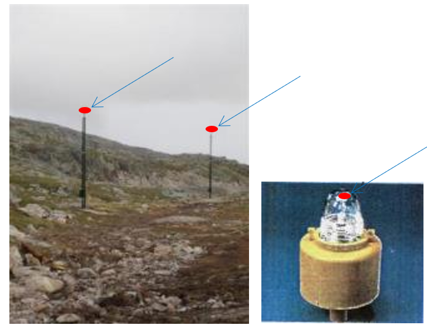
 
 
 
[discrete]
===== Lufthavnlystype - Kodenavn: Hinderlys
*Definisjon:* Lys p&#229; p&#229; objekter som kan v&#230;re til hinder for luftfart&#248;yer p&#229; bakken, landing/letting eller i lufta. Hinderlysene kan ligge p&#229; terrenget eller v&#230;re montert i stolper, master, bygninger eller andre konstruksjoner.  
 
.Eksempel på registrering av hinderlys i stolpe.
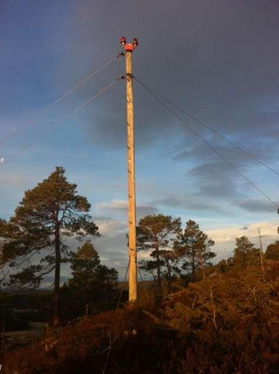
 
 
 
[discrete]
===== Lufthavnlystype - Kodenavn: Innflygningsblinkfyr
*Definisjon:* Innflygingsblinkfyr kan v&#230;re plassert p&#229; samme stolpe som innflygingslysene, eller st&#229; separat, men vil uansett st&#229; p&#229; linje i forlengelse av rullebanens senterlinje
 
.Figur som viser typisk plassering av blinkfyr (lystype 16) og innflygningslys med høy (lystype 14) og lav (lystype 14) intensitet
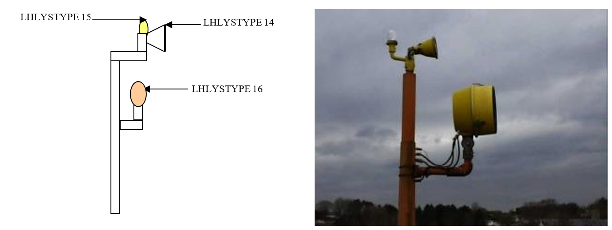
 
 
 
[discrete]
===== Lufthavnlystype - Kodenavn: Sirklingslys
*Definisjon:* Lys som visuelt leder piloten i rett kurs under sirklingsprosedyrer, farge hvit blinklys eller fast gult lys.
 
.Ekspempel på registrering av sirklingslys
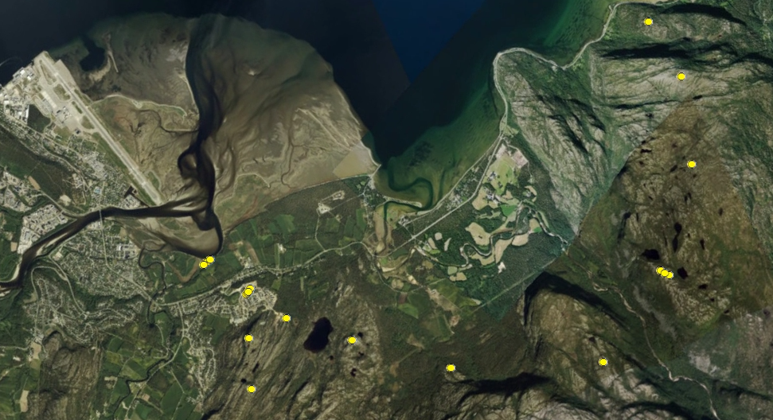
 
 
 
[discrete]
===== Lufthavnlystype - Kodenavn: Innflygningsledelys
*Definisjon:* Gir en forsterket visuell referanse langs en spesiell innflygingsl&#248;ype, f.eks for &#229; unng&#229; hinder.
 
.Eksempel på registrering av innflygningsledelys
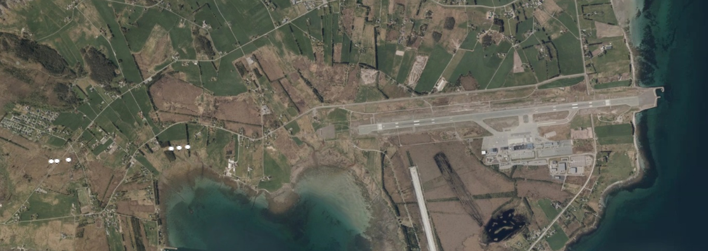
 
 
 
[discrete]
===== Lufthavnlystype - Kodenavn: Innflygningslys, høy intensitet
*Definisjon:* Innflygingslys er spesielt utformet for &#229; f&#248;re fly til landingssonen/terskel. Lysene st&#229;r p&#229; en rekke langs innflygingen, avbrutt av lyslinjer p&#229; tvers av innflygingen (tverrbarer). H&#248;yintense lys peker i innflyingsretningen.
 
.Eksempel på registrering av innflygningslys på tverrbar
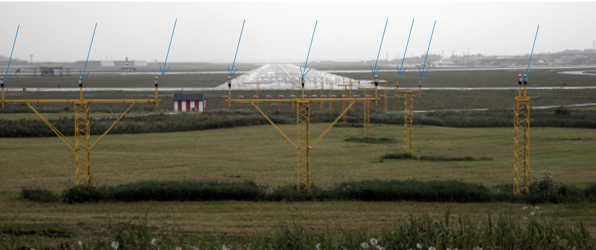
 
 
 
[discrete]
===== Lufthavnlystype - Kodenavn: Innflygningslys, lav intensitet
*Definisjon:* Innflygingslys er spesielt utformet for &#229; f&#248;re fly til landingssonen/terskel. Lysene st&#229;r p&#229; en rekke langs innflygingen, avbrutt av lyslinjer p&#229; tvers av innflygingen (tverrbarer). Lavintense lys sitter litt bak og opp for de h&#248;yintense.
 
.Bilde som viser typisk plassering av lavintenst lys
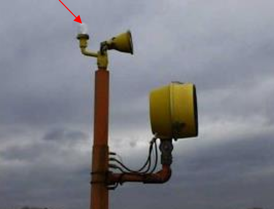
 
 
// End of Registreringsinstruks UML-model
